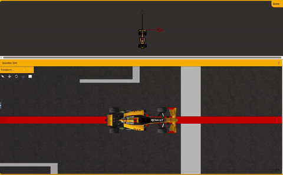

# Memoria de Práctica: Fórmula 1 con evasión de obstáculos mediante VFF

### Robótica Móvil — 3º Ingeniería de Robótica Software

---

## 1. Objetivo de la práctica

El objetivo de esta práctica es programar en Python el controlador de un Fórmula 1 simulado en **Unibotics**, dentro del ejercicio de *Obstacle Avoidance* de JdeRobot Robotics Academy. El coche tiene que recorrer la pista, cuya trayectoria ideal está marcada con una línea roja, y esquivar los coches amarillos que están colocados como obstáculos estáticos.

A diferencia de la práctica anterior de seguimiento de línea, en esta no utilizo la cámara para localizar el rojo. La navegación se basa en los datos del láser y en los puntos objetivo (*targets*) que proporciona el ejercicio. Los comandos de movimiento se envían con `HAL.setV()` y `HAL.setW()`, y el ciclo principal se regula con `Frequency.tick()`.

El objetivo principal es implementar un **Virtual Force Field (VFF)**. La idea es combinar una fuerza que guíe el coche hacia el siguiente punto de la trayectoria con otra que lo aparte de los obstáculos. Después, la dirección resultante se transforma en velocidad angular y se adapta la velocidad lineal para que pueda girar y esquivar sin perder el control.

Desde el principio me interesaba que no se limitase a evitar un obstáculo aislado, sino que pudiese completar el circuito entero y recuperar la trayectoria después de cada maniobra.

---

## 2. Planteamiento inicial

Después de revisar la documentación del ejercicio, separé el problema en cuatro partes:

- **Obtener la trayectoria deseada** mediante el siguiente `target` de `WebGUI`.
- **Procesar el láser** para saber qué distancia hay delante y a ambos lados del coche.
- **Implementar el VFF**, sumando la contribución de atracción hacia la trayectoria y la repulsión de los obstáculos.
- **Controlar la velocidad** para poder tomar las curvas y hacer las maniobras de evasión de forma estable.

Mi primera idea era combinar un vector X de avance con un vector Y de repulsión lateral. Mantengo esa idea, pero añado la dirección del `target` al cálculo: si solo se fuerza una componente X positiva y se usa la repulsión lateral, el coche puede avanzar bien en una recta, pero seguir una curva cerrada resulta más complicado.

El sistema de coordenadas que utilizo es el que nos recomendó el profesor:

- **X positiva:** hacia delante del coche.
- **Y positiva:** hacia la izquierda.

Con esta convención, un obstáculo detectado a la izquierda genera una repulsión hacia la derecha, y viceversa.

---

## 3. Arquitectura del código

Dejé todo en **un único archivo Python**, organizado en clases, para poder subirlo directamente al editor de Unibotics. Cada clase tiene una responsabilidad concreta:

| Clase o función | Responsabilidad |
|---|---|
| `clip_value()` | Limita valores como fuerzas, velocidades y ángulos a un rango definido. |
| `absolute_to_relative()` | Convierte las coordenadas globales del objetivo a coordenadas relativas al coche. |
| `LaserProcessor` | Valida las lecturas del láser y calcula distancias mínimas y espacio disponible en distintos sectores. |
| `TargetTracker` | Obtiene el siguiente objetivo, calcula su posición local y lo marca como alcanzado cuando corresponde. |
| `ObstacleVector` | Calcula la componente lateral de repulsión a partir de las lecturas del láser. |
| `ObstacleAvoider` | Decide por qué lado pasar y gestiona la activación y finalización de la evasión. |
| `SpeedPlanner` | Suaviza los cambios de velocidad, limitando la aceleración y la deceleración. |
| `VFFNavigator` | Combina atracción y repulsión, calcula el ángulo de dirección y decide las velocidades. También contiene una maniobra de recuperación de emergencia. |
| `Driver` | Coordina los módulos y muestra trazas de diagnóstico por consola. |
| `main()` | Ejecuta el bucle principal, lee la pose y el láser y envía los comandos al coche. |

Los parámetros ajustables están agrupados al principio del archivo. Así puedo retocar la respuesta del coche sin tener que modificar la lógica de las clases cada vez.

---

## 4. Percepción: procesamiento del láser

### 4.1 Lecturas y sistema de coordenadas

El programa obtiene las medidas mediante `HAL.getLaserData()` y lee su atributo `values`. En el ejercicio se utilizan 180 rayos, con el índice 90 aproximadamente en la dirección frontal. El ángulo de cada lectura se calcula así:

```python
angle = math.radians(index - LASER_FRONT_INDEX)
```

Con `LASER_FRONT_INDEX = 90`, los ángulos negativos corresponden a la derecha y los positivos a la izquierda. Las distancias no válidas, infinitas o demasiado pequeñas se descartan para que no provoquen fuerzas sin sentido.

Para tomar decisiones no utilizo todos los rayos de la misma forma. Calculo distancias mínimas en sectores concretos: uno estrecho para detectar un peligro frontal y otros laterales para estimar por dónde hay más espacio.

### 4.2 Distancia frontal y espacio lateral

Distingo entre dos medidas frontales:

- **Sector de activación:** se utiliza para decidir si hay un obstáculo delante que justifique iniciar una evasión.
- **Sector de frenado:** se utiliza para adaptar la velocidad según la distancia que queda libre delante.

También comparo el espacio a izquierda y derecha. En vez de depender únicamente de la media de todas las lecturas, utilizo un percentil bajo de las distancias del sector. De esta forma, unos pocos rayos que indiquen una pared cercana no quedan ocultos por muchos rayos que apunten a una zona despejada.

Este procesamiento no identifica por el color si una superficie es un coche o una pared. El láser mide distancias, así que el programa decide en función de la geometría detectada.

---

## 5. Seguimiento de los targets

El ejercicio proporciona los objetivos con `WebGUI.getNextTarget()`. La posición de cada objetivo está en coordenadas globales, igual que la pose del coche obtenida con `HAL.getPose3d()`. Para calcular la dirección correcta, primero transformo el objetivo al sistema local del coche.

Si la diferencia entre las posiciones globales es `dx`, `dy` y la orientación del coche es `yaw`, la transformación es:

```python
local_x = dx * cos(yaw) + dy * sin(yaw)
local_y = -dx * sin(yaw) + dy * cos(yaw)
```

Así, `local_x` representa la distancia hacia delante y `local_y` la distancia lateral hacia la izquierda.

No basta con llamar a `getNextTarget()` en cada ciclo: hay que indicar cuándo se ha alcanzado el objetivo mediante `target.setReached(True)`. Para evitar cambios demasiado pronto, utilizo un radio de llegada y una comprobación adicional cuando el punto queda ligeramente detrás del coche y sigue estando cerca. También limito el número de objetivos que se pueden avanzar en un mismo ciclo, para no saltar varios puntos de golpe.

Este apartado resultó importante al revisar las curvas. Si el objetivo se marca como alcanzado demasiado pronto o la dirección hacia él no se calcula bien, el coche puede empezar a girar tarde o cortar la curva.

---

## 6. VFF: combinación de atracción y repulsión

### 6.1 Vector de atracción

La atracción se calcula a partir del ángulo al objetivo local:

```python
target_bearing = math.atan2(target_y, target_x)
attractive_y = TARGET_STEERING_GAIN * math.tan(target_bearing)
```

El ángulo se limita para no solicitar de golpe una dirección demasiado extrema. La fuerza de atracción que uso tiene una componente longitudinal positiva y una componente lateral calculada con el ángulo del objetivo:

```python
attractive_vector = [FORWARD_FORCE, attractive_y]
```

La componente X mantiene la intención de avanzar, mientras que la Y orienta el coche hacia la trayectoria. Cuando el objetivo queda prácticamente detrás, la dirección puede ser ambigua; en ese caso conservo temporalmente el sentido de giro anterior para evitar que el controlador alterne de izquierda a derecha debido al ruido.

### 6.2 Vector de repulsión

Para cada lectura válida dentro del rango de influencia, calculo una contribución que aumenta al acercarse al objeto. La parte principal de la fórmula es:

```python
potential = (1.0 / distance) - (1.0 / REPULSION_RANGE)
magnitude = REPULSION_GAIN * potential / (distance * distance)
repulsion_y -= math.sin(angle) * magnitude
```

Solo utilizo la componente lateral de la repulsión. Un punto detectado a la izquierda aporta una fuerza hacia la derecha, mientras que uno detectado a la derecha aporta una fuerza hacia la izquierda. Las contribuciones se acumulan y luego se limitan para que un grupo de lecturas cercanas no genere un valor descontrolado.

La intensidad decrece hasta cero al llegar al límite de influencia `REPULSION_RANGE`. Por tanto, los obstáculos lejanos apenas intervienen y los cercanos tienen más peso.

### 6.3 Vector resultante y dirección

La componente lateral de dirección se obtiene sumando la atracción y la repulsión:

```python
direction_x = FORWARD_FORCE
direction_y = attractive_y + repulsion_y
direction_angle = math.atan2(direction_y, direction_x)
```

La componente X se mantiene positiva y la Y es la que se modifica con la trayectoria y los obstáculos. Después convierto el ángulo en una velocidad angular:

```python
angular_velocity = clip_value(
    K_ANGULAR * direction_angle, -W_MAX, W_MAX
)
```

Este enfoque sigue la idea que nos recomendó el profesor: conservar una componente de avance y utilizar principalmente la componente lateral para evitar los obstáculos. También limita el giro para que el comando no supere la capacidad configurada del vehículo.

---

## 7. Decisión del lado de evasión

La suma de fuerzas por sí sola no siempre decide de forma clara hacia qué lado debe pasar el coche. Por ejemplo, si un obstáculo está justo delante, las contribuciones de izquierda y derecha pueden compensarse. Por eso añadí una clase `ObstacleAvoider` que toma una decisión explícita cuando se detecta un obstáculo frontal cercano.

La decisión se basa principalmente en comparar el espacio libre a izquierda y derecha. Si los dos lados tienen una disponibilidad parecida, utilizo la dirección del objetivo como criterio secundario y, si sigue habiendo empate, mantengo el último lado elegido.

Una vez iniciada la evasión, mantengo una preferencia lateral para evitar que el coche cambie continuamente de opinión mientras pasa junto al obstáculo. Esta preferencia se suma a la repulsión del láser, pero solo mientras la maniobra sigue activa.

### 7.1 Finalización de la evasión

En la primera versión, la evasión podía mantenerse activa demasiado tiempo porque se utilizaba un sector frontal amplio para comprobar si el camino estaba libre. En una curva, ese sector puede incluir la pared lateral y hacer que el sistema interprete que todavía hay un obstáculo delante.

Lo cambié para usar un sector frontal más estrecho en la detección y en la liberación. También compruebo si el obstáculo ya ha quedado desplazado hacia un lateral y el frente vuelve a estar razonablemente despejado. Además, utilizo una condición de rearme para no volver a iniciar la misma maniobra inmediatamente después de finalizarla.

Con estos cambios el sistema diferencia mejor entre estar esquivando un coche y seguir una curva de la pista.

---

## 8. Control de velocidad

No quería que el coche mantuviese siempre una velocidad fija. Una velocidad alta puede funcionar en una recta, pero ser demasiado elevada cuando el objetivo exige un giro pronunciado o hay un obstáculo cerca.

La velocidad objetivo resta penalizaciones a la velocidad máxima:

```python
turn_penalty = (
    K_SPEED_TARGET_BEARING * abs(target_bearing)
    + K_SPEED_TURN * abs(direction_angle)
)

obstacle_penalty = OBSTACLE_BRAKE_MAX * obstacle_urgency

target_velocity = clip_value(
    V_MAX - turn_penalty - obstacle_penalty,
    V_MIN,
    V_MAX,
)
```

La primera penalización depende de la dirección del objetivo y del giro que solicita el VFF. La segunda depende de la distancia medida en el sector de frenado: cuanto más cerca está el obstáculo, mayor es la reducción de velocidad.

El `SpeedPlanner` aplica esa velocidad objetivo de forma progresiva. Limita la aceleración y la deceleración, de modo que el coche no cambia de velocidad de manera instantánea. La aceleración se puede ajustar por separado para permitir que recupere velocidad con rapidez al salir de una curva o terminar una evasión.

---

## 9. Recuperación de emergencia

También añadí una protección para una situación extrema: si la distancia del sector frontal cae por debajo de `EMERGENCY_FRONT_DISTANCE`, el programa deja de insistir en avanzar hacia la pared. Intenta retroceder durante un intervalo corto y girar hacia el lado elegido para la evasión. Después aplica un tiempo de espera para no repetir continuamente la marcha atrás.

Esta medida no sustituye al VFF normal; es una salvaguarda para cuando el frontal está prácticamente bloqueado. En las pruebas finales el objetivo principal fue evitar llegar a esa situación, pero me pareció útil que el programa tenga una respuesta definida si ocurre.

---

## 10. Bucle principal y herramientas de depuración

El bucle principal lee la pose con `HAL.getPose3d()` y el láser con `HAL.getLaserData()`. El intervalo de tiempo se mide con `time.monotonic()` y se limita a un rango razonable antes de actualizar el controlador. En cada iteración se calculan las velocidades y se envían con `HAL.setV()` y `HAL.setW()`. El ciclo se regula con `Frequency.tick(LOOP_HZ)`.

También utilizo las funciones de visualización disponibles en `WebGUI`:

- `WebGUI.showForces()` para mostrar los vectores de atracción, repulsión y dirección resultante.
- `WebGUI.showLocalTarget()` para visualizar el objetivo local respecto al coche.

Por consola se imprimen trazas con el objetivo, su distancia y ángulo, las componentes laterales de atracción y repulsión, la distancia frontal, el espacio disponible a ambos lados, el lado seleccionado y las velocidades `V` y `W`. Estas trazas fueron especialmente útiles para entender por qué fallaba la curva superior izquierda.

Si ocurre un error durante el ciclo, el programa intenta enviar velocidades cero para detener el coche en lugar de mantener un comando anterior. Al salir del bucle también envía comandos de parada.

---

## 11. Proceso de pruebas y afinado de parámetros

Fui probando el programa en el circuito y cambiando los parámetros a partir de lo que hacía el coche, en vez de modificar muchas cosas a la vez.

| Iteración | Cambio | Resultado observado |
|---|---|---|
| 0 | Primera versión del VFF, con atracción hacia delante y repulsión lateral. | Completa gran parte del circuito, pero falla en una curva de la zona superior izquierda y termina chocando contra la pared. |
| 1 | Revisión del seguimiento de objetivos y de la lógica de evasión: sector frontal más estrecho, liberación de la maniobra según el espacio frontal y el desplazamiento lateral del obstáculo, y rearme para evitar oscilaciones de estado. | El coche completa el circuito, aunque la evasión se vuelve algo más lenta y presenta pequeños balanceos. También reduce demasiado la velocidad en algunas curvas. |
| 2 | Ajuste de las penalizaciones de velocidad, del frenado por obstáculos y de la aceleración. | Mejora el ritmo en curvas sin perder la velocidad adecuada en las rectas. |
| 3 | Reducción moderada de la ganancia de repulsión y de la preferencia lateral añadida durante la evasión. | La ejecución resulta más fluida y el coche completa el recorrido de forma satisfactoria. |

La curva problemática fue importante para encontrar el fallo. En las trazas anteriores al choque aparecía una distancia frontal de apenas `0.08 m`, un ángulo deseado de `1.19 rad` y una velocidad angular saturada en `W = 1.50`. Esto indicaba que el coche estaba intentando girar mucho cuando ya tenía muy poco espacio para reaccionar.

No medí un tiempo de vuelta antes y después de cada ajuste, así que no incluyo una comparación numérica de tiempos. La mejora que sí pude comprobar fue cualitativa: el coche pasó de quedarse atascado en esa curva a completar el recorrido, y después de los últimos cambios la evasión se volvió más fluida y la velocidad en las curvas fue más adecuada.

### Parámetros finales utilizados

Estos son los valores que dejé tras las pruebas de velocidad y suavidad. Mantengo la tabla agrupada por función porque así es más fácil volver a ajustar el comportamiento si hiciera falta.

| Grupo | Parámetros finales |
|---|---|
| Ciclo y diagnóstico | `LOOP_HZ = 30`, `LOG_EVERY_S = 0.25` |
| Targets | `TARGET_REACHED_RADIUS = 1.15`, `TARGET_PASS_DISTANCE = 2.25`, `TARGET_PASS_BEHIND_X = -0.15`, `MAX_TARGET_ADVANCES_PER_CYCLE = 3` |
| Láser y repulsión | `REPULSION_RANGE = 4.5`, `REPULSION_GAIN = 0.72`, `REPULSION_Y_LIMIT = 2.2`, `DIRECTION_Y_LIMIT = 3.0` |
| Atracción | `FORWARD_FORCE = 1.20`, `TARGET_STEERING_GAIN = 1.0`, `MAX_TARGET_BEARING = 0.95`, `ATTRACTIVE_Y_LIMIT = 1.60` |
| Evasión | `FRONT_ACTIVATION_DEG = 14.0`, `FRONT_BRAKE_DEG = 17.0`, `AVOID_ACTIVATION_DISTANCE = 3.8`, `AVOID_RELEASE_DISTANCE = 4.6`, `SIDE_BIAS_MAX = 1.10` |
| Frenado por obstáculos | `OBSTACLE_BRAKE_MAX = 3.6`, `OBSTACLE_BRAKE_START = 3.4`, `OBSTACLE_BRAKE_STOP = 0.65` |
| Control de giro | `K_ANGULAR = 1.65`, `W_MAX = 1.5` |
| Velocidad | `V_MAX = 7.0`, `V_MIN = 1.2`, `K_SPEED_TARGET_BEARING = 1.8`, `K_SPEED_TURN = 1.6`, `ACCELERATION = 4.5`, `DECELERATION = 8.0` |
| Recuperación | `EMERGENCY_FRONT_DISTANCE = 0.22`, `RECOVERY_REVERSE_SPEED = -0.75`, `RECOVERY_REVERSE_SECONDS = 0.45`, `RECOVERY_COOLDOWN_SECONDS = 0.90`, `RECOVERY_TURN_RATE = 0.70` |

---

## 12. Limitaciones observadas y posibles mejoras

Aunque el comportamiento final es bueno en el circuito probado, hay algunas limitaciones que tendría en cuenta si quisiera seguir mejorándolo:

- **El láser no distingue tipos de superficie.** Detecta distancias, no colores. Por eso el algoritmo trata las paredes y los coches como superficies que pueden limitar el espacio, y necesita combinar la información geométrica con los objetivos del circuito.
- **El VFF puede cambiar si varían mucho las lecturas.** La reducción de la ganancia de repulsión ayudó a que la maniobra fuese menos nerviosa, pero no elimina por completo la posibilidad de pequeñas oscilaciones en otros escenarios.
- **Los parámetros se han ajustado al circuito probado.** No he verificado que esta configuración tenga el mismo comportamiento en todos los circuitos disponibles o con otras distribuciones de obstáculos.
- **La recuperación de emergencia depende de la respuesta del simulador a velocidades negativas.** En la práctica final no ha sido necesario apoyarse continuamente en esta maniobra, pero conviene comprobarla en cualquier entorno nuevo.

Una posible mejora futura sería filtrar suavemente el comando angular para eliminar pequeñas variaciones entre ciclos, sin retrasar una maniobra cuando el obstáculo está demasiado cerca. También se podría estudiar una medida más explícita de la curvatura de la trayectoria para anticipar algunas curvas sin frenar más de lo necesario.

---

## 13. Demostración en vídeo

[]

---

## 14. Conclusiones

El resultado final es un controlador que combina la información de los targets con el láser para recorrer el circuito y esquivar los obstáculos mediante un VFF. La parte más importante no fue únicamente calcular dos fuerzas y sumarlas, sino conseguir que el coche mantuviera una dirección razonable en las curvas y que no siguiera intentando una evasión cuando el obstáculo ya había quedado atrás.

Lo que más me ha servido de esta práctica:

- **El seguimiento de la trayectoria y la evasión tienen que trabajar juntos.** Si la atracción hacia el objetivo no tiene en cuenta su dirección real, el coche puede responder bien en rectas pero fallar en curvas cerradas.
- **La lógica que gestiona la evasión importa tanto como la fuerza repulsiva.** Decidir cuándo empezar, qué lado escoger y cuándo terminar la maniobra evita muchos cambios de dirección innecesarios.
- **El láser necesita interpretarse por sectores.** Comparar el frente con los laterales permite diferenciar si hay un obstáculo en la trayectoria o si parte de las lecturas corresponden a las paredes de una curva.
- **La velocidad tiene que adaptarse a la dirección y al espacio disponible.** Penalizar demasiado los giros vuelve el coche excesivamente lento; penalizar demasiado poco puede hacer que llegue sin margen a una curva o a un obstáculo.
- **Las trazas ayudan a corregir con datos.** Ver la distancia frontal, el ángulo deseado y las velocidades justo antes del choque permitió identificar que el coche estaba pidiendo un giro muy grande cuando ya casi no tenía espacio.

Después de corregir el seguimiento de los objetivos y la liberación de la evasión, y de ajustar las penalizaciones de velocidad y la repulsión, el coche completa el circuito y la maniobra alrededor de los obstáculos es más fluida. Para mí, el principal aprendizaje ha sido que un VFF no consiste solo en sumar vectores: también hay que diseñar bien cuándo actúa cada parte del controlador y comprobar su comportamiento en el simulador.