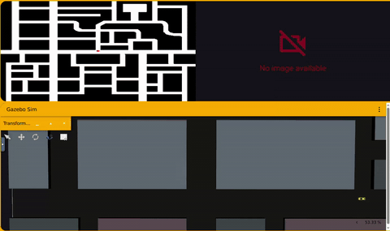

# Memoria de Práctica: Navegación Global (TeleTaxi)
### Robótica Móvil — 3º Ingeniería de Robótica Software

---

## 1. Objetivo de la práctica

El objetivo de esta práctica es programar un coche autónomo en Python, utilizando el entorno **TeleTaxi de JdeRobot Robotics Academy (Unibotics)**, para que funcione como un taxi autónomo. El coche dispone de su posición (GPS) y de un **mapa de la ciudad**, y debe ser capaz de ir desde el punto en el que se encuentra hasta el destino que el usuario marca picando en el mapa.

La planificación tiene que hacerse con el algoritmo de **Gradient Path Planning (GPP)**. Este algoritmo es un ejemplo de **plan como recurso**: genera un campo escalar que el robot puede consultar en cualquier momento para saber hacia dónde moverse. El campo debe ser la **suma de dos subcampos**: el de propagación a destino y el de penalización por cercanía a obstáculos.

Además, el coche debe pilotarse siguiendo el gradiente de ese campo dentro de un **bucle reactivo**, gobernando la velocidad lineal (`HAL.setV()`) y la angular (`HAL.setW()`) en cada iteración. Una vez alcanzado un destino, el coche debe esperar a que el usuario marque uno nuevo.

---

## 2. Planteamiento inicial

Mi primera versión ya era completamente funcional: el coche llegaba a cualquier destino de la ciudad sin chocar. Funcionaba así:

- Calculaba un **Dijkstra desde el destino**, en el que la penalización por cercanía a los edificios multiplicaba el coste de cada paso.
- Para cada celda guardaba cuál era la siguiente hacia el destino, y con eso **extraía la ruta completa** desde la posición del coche.
- El coche **seguía esa ruta como una lista de waypoints**: buscaba el waypoint más cercano y apuntaba a otro situado 5 m por delante.

Al releer el enunciado me di cuenta de que, aunque funcionaba, no cumplía tres de los requisitos:

- **El campo no era una suma de dos subcampos.** La penalización iba multiplicada dentro del coste de Dijkstra, así que solo existía un campo mezclado.
- **Estaba usando el plan como un plan clásico.** Extraer una ruta y seguirla punto a punto es una secuencia de subobjetivos, justo lo contrario de un plan como recurso.
- **La propagación recorría el mapa entero**, cuando en GPP la onda se detiene al llegar al punto de partida.

Visto esto, decidí rehacer la planificación y el seguimiento manteniendo todo lo que ya funcionaba: la carga del mapa, la conversión de coordenadas, el controlador y la gestión de destinos.

---

## 3. Decisión de usar el plan como recurso

El cambio más importante fue dejar de guardar una ruta. En la versión final, el resultado de la planificación es únicamente un **campo de costes**: una matriz en la que cada celda de carretera tiene un valor que es más bajo cuanto más cerca está del destino y más alto cuanto más cerca está de un edificio.

El robot no sigue ninguna lista de puntos. En cada iteración del bucle consulta el campo desde la celda en la que se encuentra y baja por él unas pocas celdas. El punto al que llega es su objetivo para esa iteración.

Esto tiene una ventaja clara frente a la versión anterior: si el coche se desvía, no hay ninguna ruta que deje de ser válida. El campo le sigue indicando hacia dónde ir desde su nueva posición, sin tener que replanificar.

La planificación solo se ejecuta cuando cambia el destino. El resto del tiempo el campo simplemente se consulta.

---

## 4. Representación del mapa

### 4.1 Mapa de la ciudad

El mapa se obtiene con `WebGUI.getMap()` y es una imagen de **400 × 400 píxeles** en escala de grises con solo dos valores: `255` para las carreteras y `0` para los edificios. Cada celda de la matriz es una celda del mapa sobre la que se planifica.

### 4.2 Conversión de coordenadas

Según la API, el mundo de Gazebo mide **500 × 500 m** centrado en el origen, así que cada píxel equivale a **1,25 m** (0,8 píxeles por metro).

- **Del mundo al mapa** uso `WebGUI.rowColumn()`. Tuve que tener en cuenta que devuelve los índices en el orden contrario al que se usa para indexar la matriz, así que los intercambio.
- **Del mapa al mundo** aplico la relación lineal inversa: `x = (fila − 200) / 0.8` e `y = (columna − 200) / 0.8`. El punto obtenido es una esquina de la celda y no su centro, pero el error (como mucho 1,25 m) es despreciable frente a la distancia a la que apunta el coche.

### 4.3 Movimientos entre celdas

Cada celda tiene ocho vecinas: cuatro ortogonales con coste `1` y cuatro diagonales con coste `√2`. Así, los movimientos diagonales cuestan más, como corresponde a la distancia real.

Además, un movimiento diagonal solo se permite si las dos celdas ortogonales que lo rodean también son carretera. Sin esta comprobación, el camino podía cortar en diagonal la esquina de un edificio.

---

## 5. Subcampo de propagación a destino

### 5.1 La onda desde el destino

Este subcampo es la onda del GPP: se genera en el destino, con valor `0`, y se propaga por las carreteras sin atravesar los edificios. Cada celda acaba guardando la distancia hasta el destino recorriendo carreteras.

Para propagarla uso una cola de prioridad (`heapq`), expandiendo siempre primero la celda con menor coste acumulado. Propagar la onda de esta forma es **equivalente a un Dijkstra desde el destino**, que era lo que ya tenía. La diferencia respecto a la primera versión es que ahora el coste de cada paso es solo la distancia (`1` o `√2`), sin penalización.

### 5.2 Detener la propagación

En GPP la propagación se detiene al llegar al punto de partida. Lo implementé con una única condición al sacar cada celda de la cola:

```python
if current_cost > costs[start] + EXTRA_PROPAGATION:
    break
```

Mientras la onda no ha llegado al inicio, `costs[start]` vale infinito y la condición nunca se cumple. Cuando llega, la onda continúa un margen de `EXTRA_PROPAGATION = 20` unidades de coste (unas 20 celdas, unos 25 m) y se detiene.

No paré exactamente en el inicio a propósito: si el coche se desvía un poco hacia una zona a la que la onda no ha llegado, no tendría campo que consultar. El margen deja información válida alrededor del recorrido.

---

## 6. Subcampo de penalización y suma de campos: el camino hasta ajustarlo

Esta fue la parte que más iteraciones requirió.

### 6.1 La penalización

Para saber lo cerca que está cada celda de un edificio uso `cv2.distanceTransform()`, que devuelve la distancia de cada píxel de carretera al edificio más cercano. A partir de esa distancia `d` calculo una penalización cuadrática:

```
P(d) = λ · max(0, 1 − d/R)²
```

`λ` (`PENALTY_STRENGTH`) es la penalización máxima, pegado al edificio, y `R` (`INFLUENCE_RADIUS`) es la distancia a partir de la cual la penalización vale `0`. Este subcampo solo depende del mapa, así que lo calculo una vez al arrancar.

### 6.2 Primera versión: penalización dentro de Dijkstra

En la versión original, la penalización multiplicaba el coste de cada paso: `step_cost * (1 + P)`. Funcionaba muy bien porque la penalización se acumulaba a lo largo de todo el camino, pero no era una suma de dos subcampos como pide el enunciado.

### 6.3 Segunda versión: suma con los valores anteriores

Al separar los dos subcampos, el campo total pasa a ser:

```python
field = distances + penalties
```

El problema es que una penalización sumada empuja mucho menos que una multiplicada: ya no se acumula a lo largo del camino, solo cuenta en la celda en la que está el coche. Con los valores que tenía, el coche circulaba más pegado a los edificios que en la versión anterior.

### 6.4 Tercera versión: más penalización y mínimos locales

La solución obvia era aumentar la penalización. Al hacerlo, el coche se separaba más de los edificios, pero en muchos trayectos **dejaba de llegar al destino**: se quedaba parado en mitad de la carretera.

El motivo eran los **mínimos locales**: celdas en las que ninguna vecina tiene un valor más bajo. Si la penalización sube más deprisa de lo que baja la distancia al destino, al acercarse a un edificio puede pasar que todas las vecinas tengan un valor mayor, y el descenso se detiene allí.

### 6.5 Versión final: penalización acotada por la distancia

La condición para que no aparezcan mínimos locales es que la penalización crezca, como mucho, 1 por celda, que es lo mínimo que baja la distancia al avanzar hacia el destino. La pendiente de la penalización es:

```
|dP/dd| = (2λ / R) · (1 − d/R)
```

Si se elige `λ = R/2`, la pendiente queda `1 − d/R`, que en cualquier celda de carretera (`d ≥ 1`) es menor que 1. Por otro lado, desde cualquier celda, al moverse hacia la celda desde la que llegó la onda, la distancia baja exactamente el coste del paso, mientras que la penalización sube menos que ese coste. Por tanto, **siempre existe una vecina con menor valor** y el coche nunca se queda atascado.

Con esta regla elegí `INFLUENCE_RADIUS = 12` y `PENALTY_STRENGTH = 6`: la mayor penalización posible sin crear mínimos locales. Con estos valores el coche vuelve a circular a una distancia de los edificios similar a la de la versión original.

---

## 7. Descenso del campo: pedir consejo al plan

### 7.1 El descenso

En cada iteración, el coche convierte su posición a una celda del mapa y desde ahí baja por el campo: mira sus ocho vecinas, se mueve a la de menor valor y repite. Si ninguna vecina es más baja que la celda actual, se detiene:

```python
if field[best] >= field[row, col]:
    break
```

Por el razonamiento del apartado 6.5, esto solo ocurre al llegar al destino.

Durante el descenso solo considero vecinas dentro del mapa, de carretera, con un valor finito en el campo y que no corten en diagonal la esquina de un edificio. Es la misma regla de esquinas que usa la propagación, por lo que el descenso nunca intenta un movimiento que la onda no haya permitido.

### 7.2 Distancia de anticipación

El coche no apunta a la celda vecina, sino a la que alcanza tras `LOOKAHEAD_STEPS = 3` pasos de descenso (unos 4 m por delante). Si apunta demasiado cerca, el giro es muy brusco; si apunta demasiado lejos, la recta hasta el objetivo atraviesa las esquinas de los cruces.

Empecé con un valor equivalente a los 5 m de la versión original (4 pasos), pero en algunos cruces el coche rozaba la esquina del edificio al girar por el interior de la curva. Con 3 pasos esos roces desaparecieron.

### 7.3 Visualización

Para comprobar el resultado represento el campo total en escala de grises con `WebGUI.showNumpy()` y dibujo con `WebGUI.showPath()` la ruta que se obtiene bajando por el campo desde la posición inicial hasta el destino. Esa ruta **solo sirve para visualizar**: el coche no la sigue, sino que vuelve a consultar el campo en cada iteración.

---

## 8. Controlador de velocidades

Una vez obtenido el punto objetivo, calculo el error angular entre la orientación del coche y la dirección hacia ese punto, y lo normalizo al rango `[-π, π]` para que el coche gire siempre por el camino más corto.

La velocidad angular es proporcional al error y está limitada:

```python
angular = max(-W_MAX, min(W_MAX, K_P * error))
```

La velocidad lineal depende también del error: si supera `ANGLE_STOP = 30°`, el coche no avanza y solo gira; si no, avanza a `V_MAX · cos(error)`, de forma que va más rápido cuanto mejor orientado está:

```python
linear = 0.0 if abs(error) > ANGLE_STOP else V_MAX * math.cos(error)
```

Este controlador es el mismo que en la primera versión. Al cambiar la forma de elegir el punto objetivo no hizo falta modificarlo.

---

## 9. Gestión de destinos en el bucle principal

El bucle principal se ejecuta a frecuencia fija con `Frequency.tick()` y en cada iteración comprueba la situación del coche:

- **Sin destino:** el coche permanece parado y se descarta el campo anterior.
- **Destino nuevo:** comparo el destino actual con el anterior. Si ha cambiado, paro el coche y calculo el campo nuevo. Si el destino no está en carretera o no se puede alcanzar, se informa por consola y el coche no se mueve.
- **Destino alcanzado:** si la distancia al destino es menor que `GOAL_TOLERANCE = 2.0`, el coche se detiene y espera a que el usuario marque otro punto.
- **En camino:** descenso del campo, cálculo de velocidades y envío con `HAL.setV()` y `HAL.setW()`.

Cada `PRINT_EVERY = 30` iteraciones muestro por consola la distancia al destino, el error angular y las velocidades, para no saturar la salida.

---

## 10. Limitaciones

### 10.1 Separación de los edificios frente a mínimos locales

La regla `λ = R/2` limita lo fuerte que puede ser la penalización. Separar más el coche de los edificios y evitar mínimos locales son objetivos contrapuestos: si se aumenta `PENALTY_STRENGTH` por encima de ese valor, el coche se aleja más de las paredes, pero vuelven a aparecer celdas en las que se queda atascado.

### 10.2 Zona propagada

El campo solo es válido en la zona a la que ha llegado la onda. Si el coche saliera de ella, por ejemplo, por un desvío muy grande, el descenso no encontraría ninguna vecina más baja y el coche se detendría, ya que el campo solo se recalcula cuando cambia el destino. El margen de `EXTRA_PROPAGATION` hace que esto no ocurra en condiciones normales.

### 10.3 Cruces y esquinas

En los cruces, el camino más corto pasa cerca de la esquina interior. La penalización y la distancia de anticipación reducen este efecto, pero es la situación en la que el coche pasa más cerca de los edificios.

### 10.4 Discretización

El campo se consulta sobre celdas de 1,25 m, por lo que el descenso elige celdas vecinas y no una dirección continua. Esto hace que el punto objetivo cambie a saltos, aunque el controlador lo suaviza.

---

## 11. Flujo final

El flujo completo en la versión final es el siguiente:

```
INICIO ──► CARGA DEL MAPA ──► CAMPO DE PENALIZACIÓN
                                       │
                                       ▼
          ┌──────────────────► ESPERA DE DESTINO
          │                            │
          │                     (destino nuevo)
          │                            ▼
          │          CAMPO DE PROPAGACIÓN + PENALIZACIÓN = CAMPO TOTAL
          │                            │
          │                            ▼
          │                ┌──► DESCENSO DEL CAMPO ──► CÁLCULO DE V Y W
          │                │                                │
          │                │       (destino no alcanzado)   │
          │                └────────────────────────────────┤
          │                                                 │
          │                          (destino alcanzado)    ▼
          └────────────────────────────────────────────── PARAR
```

El campo se calcula una vez por destino. Mientras el coche no llega, el bucle vuelve directamente al descenso: el campo solo se consulta, no se recalcula. Si el usuario marca un destino distinto durante el trayecto, se calcula un campo nuevo.

---

## 12. Demostración en vídeo
[]

---

## 13. Conclusiones

El resultado final cumple los requisitos del enunciado: el campo es la suma del subcampo de propagación y el de penalización, la onda se detiene después de alcanzar el punto de partida, y el coche se pilota en un bucle reactivo consultando el campo en cada iteración, sin seguir ninguna ruta almacenada.

El aprendizaje principal de esta práctica ha sido que tener un programa que funciona no es lo mismo que implementar el algoritmo pedido. Mi primera versión llegaba a todos los destinos, pero usaba el plan como una secuencia de puntos. Pasar a un plan como recurso no requirió cambiar el algoritmo de propagación, sino la forma de usar su resultado.

También he aprendido que la forma de combinar los dos subcampos tiene consecuencias. Sumar una penalización no es lo mismo que multiplicarla, y una penalización demasiado fuerte crea mínimos locales que bloquean el descenso. Entender por qué aparecen me permitió elegir los parámetros con un criterio en lugar de por prueba y error.